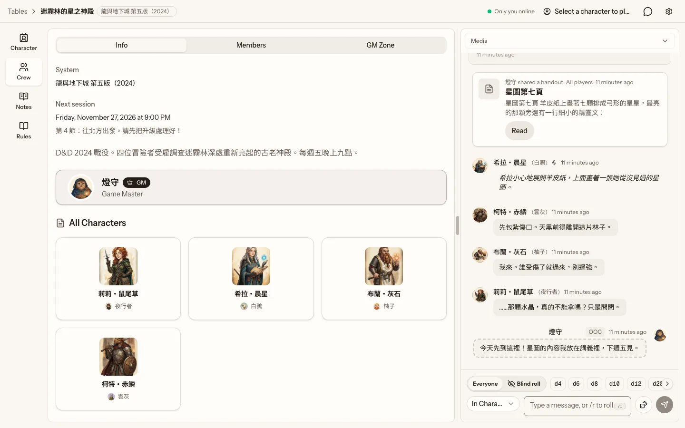
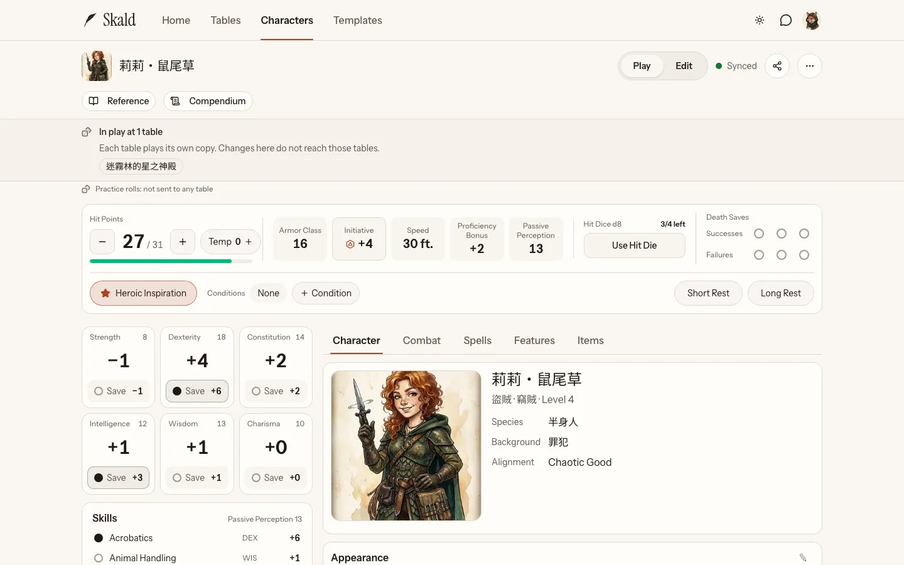
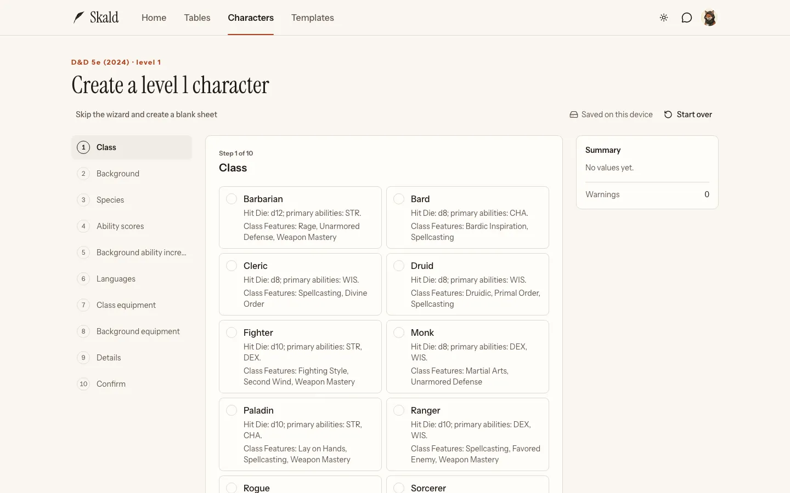
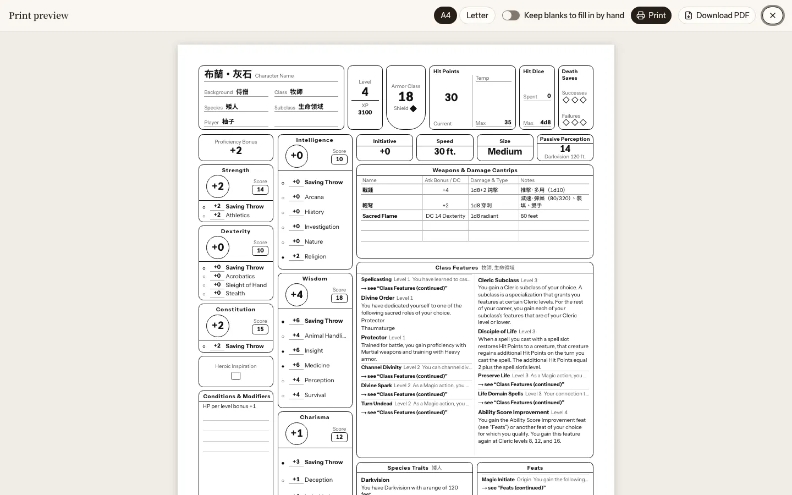
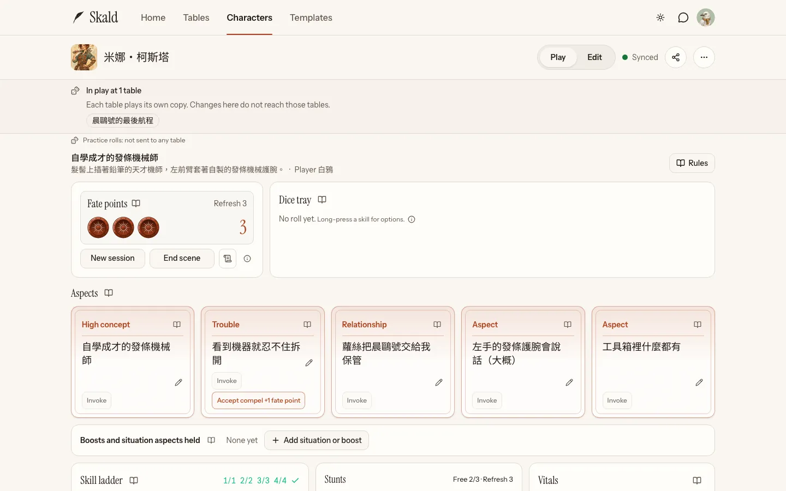
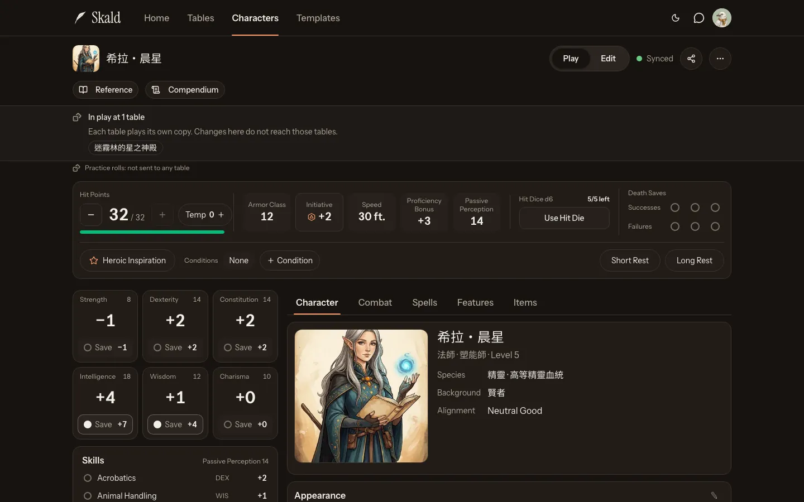

# Skald SDK

[繁體中文](README.zh-TW.md)

[Skald](https://skald.tw) is a companion for tabletop role-playing games, with character sheets, dice, and tools for running tables.
This repository contains Skald’s character sheet SDK, the Fate Condensed and D&D 2024 (SRD 5.2.1) systems, and a local previewer.

## Quick start

Use [Bun](https://bun.sh) 1.4.4 (the version used in CI) and [Node.js](https://nodejs.org) 24.
Run these commands from the repository root:

```sh
bun install
bun run ci
```

`bun run ci` checks types, runs lint and tests, and builds the previewer.
To start the previewer in development mode, run:

```sh
bun run dev
```

Open [localhost:3100/en](http://localhost:3100/en) or [localhost:3100/zh-TW](http://localhost:3100/zh-TW) and choose a system.
The previewer has play, edit, and print modes, and saves character edits in the browser.
See the [previewer guide](apps/previewer/README.md) for direct links and what to check before opening a pull request.

## Preview a system pack

Build the bundled [Lantern Bearers example](packages/sheet-sdk/src/scripts/system-pack/example/) and check the resulting file:

```sh
bun run system-pack build packages/sheet-sdk/src/scripts/system-pack/example --out lantern.json
bun run system-pack check lantern.json
bun run dev
```

1. Open [the local pack preview](http://localhost:3100/en/pack) and choose `lantern.json`.
2. In Edit, change the character name. Switch to Play and roll an attribute; check the result in the roll log.
3. Open Rules reference. Read a section, then open an entry from its collection. Search for `燈油` and open a result.
4. Open Print and check the edited name. Reload the page: the file and the character edits are gone.

The character creation wizard runs only on the site. See the [system pack guide](docs/system-packs.md) and [authoring reference (繁體中文)](docs/system-packs.zh-TW.md).

## Screenshots



| | |
|---|---|
|  |  |
| D&D 2024 sheet | Character wizard |
|  |  |
| Print preview | Fate Condensed sheet |
|  |  |
| On a phone | Dark theme |

## Repository layout

| Path | Contents |
| --- | --- |
| [`packages/`](packages/) | Sheet SDK (schema tools, renderer, and print components), shared types, dice, and formulas. |
| [`systems/`](systems/) | Fate Condensed and D&D 2024 system plugins and rules data. |
| [`apps/previewer/`](apps/previewer/) | Local Next.js app for trying character sheets. |
| [`scripts/`](scripts/) | Repository checks, including the protected-paths check. |

## Add a system or change a sheet

- To change a sheet, start with the system’s `schema.json` and `template.json`. The [Fate Condensed data](systems/fate/data/fate-condensed/) shows how the schema defines fields and the template arranges them. See the [schema and template types][sheet-types].
- To add a system, use the [Fate plugin](systems/fate/plugin.ts) as an example. Implement the [`SystemPlugin` contract][plugin-contract], have `loadBuiltinData` return the schema, template, and default character data as [`BuiltinLocalSystemData`][builtin-data], and register the plugin in the [previewer registry](apps/previewer/lib/systems.ts).
- Check the sheet in play, edit, and print modes in the previewer.
- To write a D&D 2024 content pack, check it, and load it in the previewer, see [Content packs](docs/content-packs.md).

## Contributing

Read [CONTRIBUTING.md](CONTRIBUTING.md) before opening a pull request.
Open an issue first for anything larger than a small fix, and give the source and license of any third-party material in the pull request.
On the first pull request, sign the [Contributor License Agreement](CLA.md) when cla-assistant prompts for it.
Pull requests require a [code owner](CODEOWNERS) review and passing checks for the CLA, protected paths, and CI (type checks, lint, tests, and the previewer build).

## License and attribution

The project is licensed under [Apache-2.0](LICENSE), except for third-party material under its own licenses.
D&D SRD 5.2.1 material is CC BY 4.0, and Fate SRD material is CC BY 3.0.
Game-Icons.net icons are CC BY 3.0 unless listed as CC0 or public domain.
See [NOTICE](NOTICE) for full attributions and [TRADEMARKS.md](TRADEMARKS.md) for trademark terms.
Text this repository may not redistribute, such as material from a book you own, belongs in a content pack that each player keeps for themselves; [Content packs](docs/content-packs.md) explains where the line runs.

[sheet-types]: packages/types/src/schema.ts
[plugin-contract]: packages/sheet-sdk/src/modules/systems/domain/system-plugin.ts
[builtin-data]: packages/sheet-sdk/src/modules/systems/domain/builtin-local-system-data.ts
